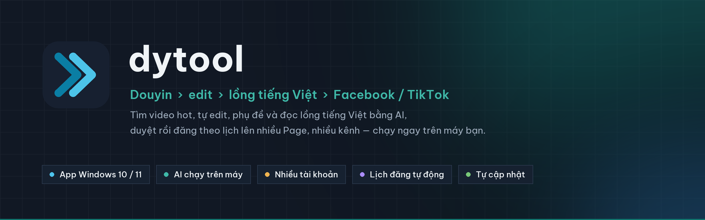
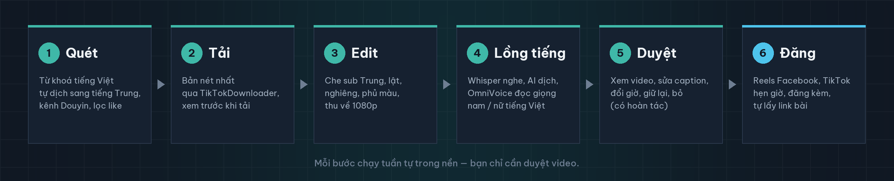
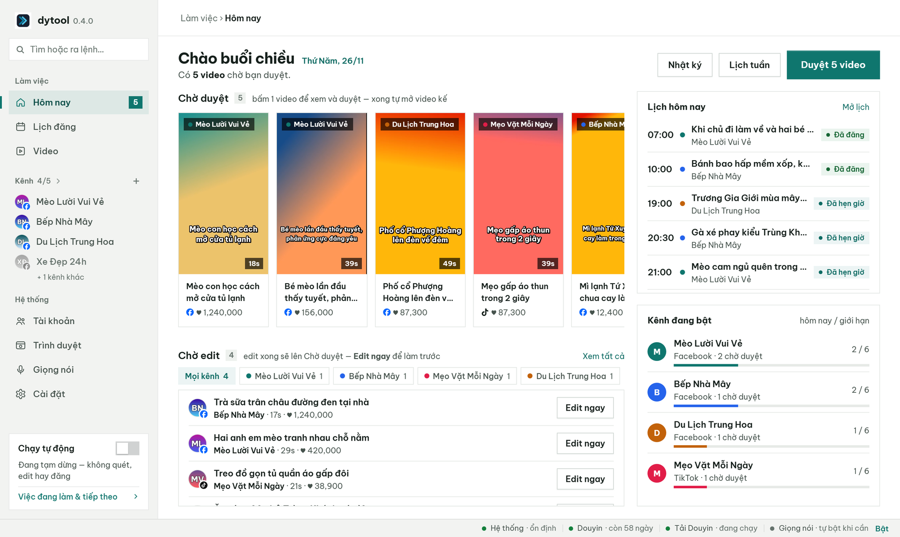
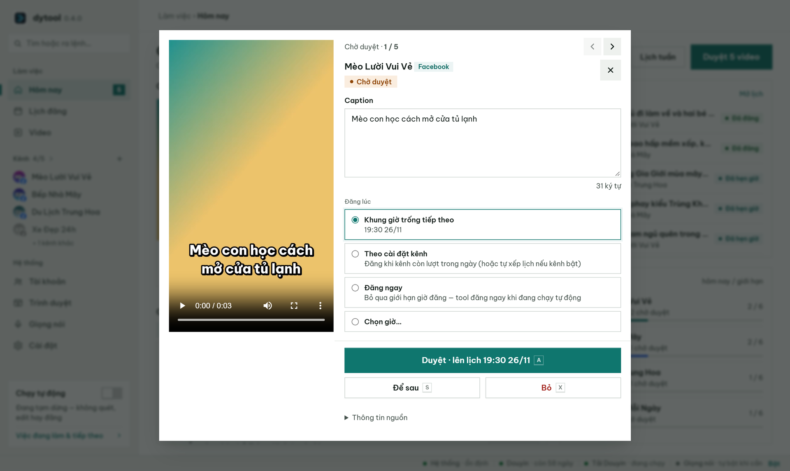
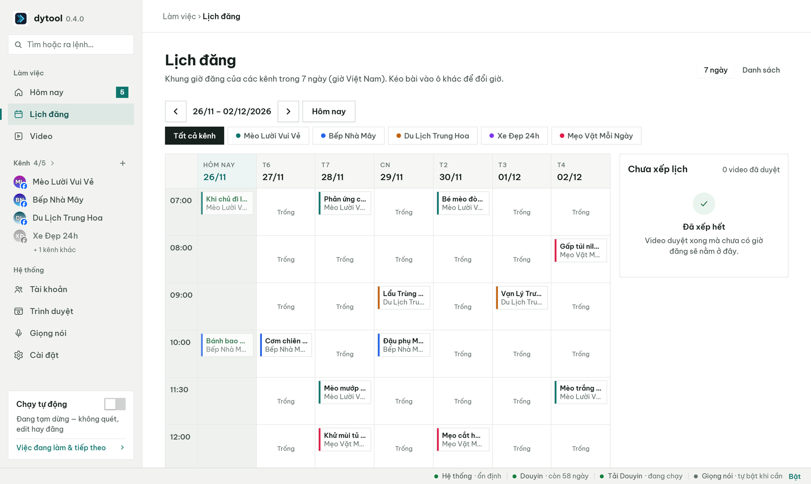
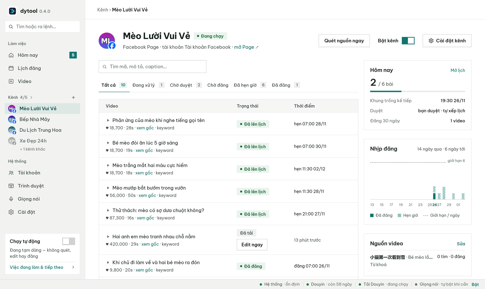
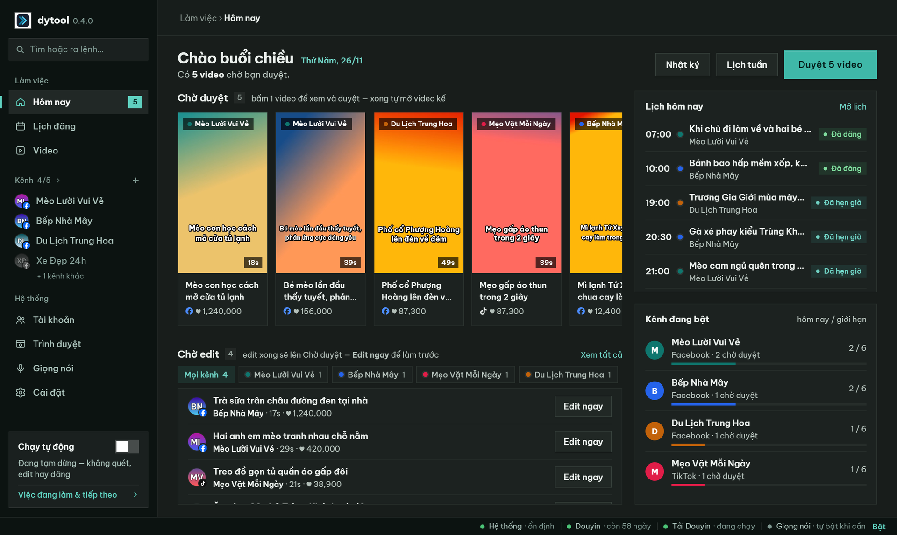
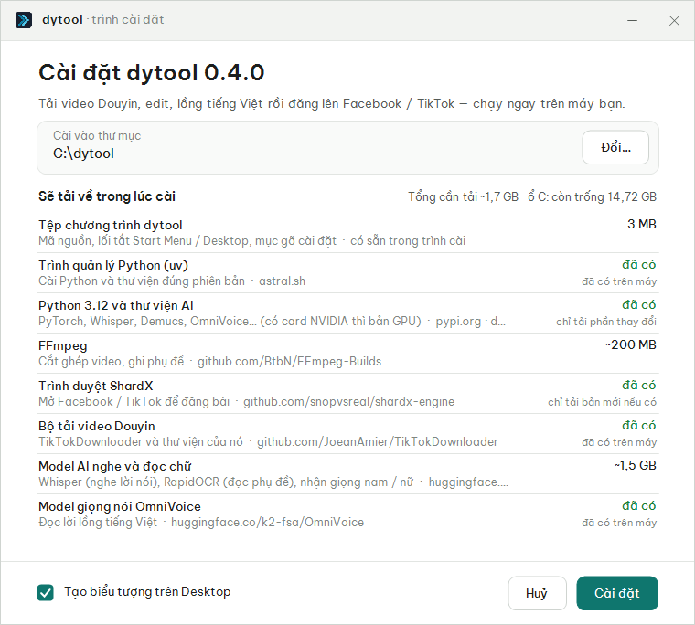
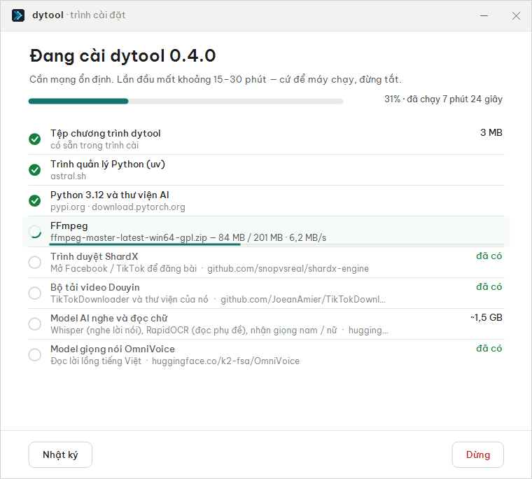

 

**Biến video Douyin hot thành Reels tiếng Việt — tự tìm, tự edit, tự lồng tiếng, bạn chỉ việc duyệt.**

    

[**Tải bản mới nhất**](https://github.com/snopvsreal/dytool/releases/latest) · [Giao diện](#-giao-diện) · [Tính năng](#-tính-năng) · [Cài đặt](#-cài-đặt) · [Hướng dẫn nhanh](#-bắt-đầu-trong-5-phút) · [Có gì mới](CHANGELOG.md) · [Lập trình viên](docs/DEVELOPMENT.md)

---

## ✨ dytool là gì?

**dytool** là app Windows giúp bạn vận hành nhiều Page Facebook và kênh TikTok bằng video ngắn từ Douyin (TikTok
Trung Quốc). Bạn gõ chủ đề bằng **tiếng Việt** — dytool tự dịch sang tiếng Trung, tìm video đang hot, tải bản nét
nhất, edit cho khác bản gốc, dịch và **đọc lồng tiếng Việt bằng AI ngay trên máy bạn**, rồi xếp lịch đăng. Việc của
bạn chỉ còn là lướt qua và bấm **Duyệt**.

  

- 🖥️ **App thật, không phải web** — cửa sổ riêng, thu xuống khay, chạy nền cả ngày.
- 🔒 **Dữ liệu ở trên máy bạn** — model giọng nói, nhận dạng giọng, OCR đều chạy cục bộ; không cần API key.
- 🇻🇳 **Làm cho người Việt** — giao diện, phụ đề, giọng đọc, hướng dẫn đều tiếng Việt; giờ đăng theo giờ Việt Nam.

## 📸 Giao diện

  
   <b>Hôm nay</b> — video chờ duyệt, video chờ edit, lịch đăng hôm nay và các kênh, gọn trong 1 màn hình

<table>
<tr>
<td width="50%"></td>
<td width="50%"></td>
</tr>
<tr>
<td align="center"><b>Duyệt</b> — xem video, sửa caption, chọn giờ đăng</td>
<td align="center"><b>Lịch đăng</b> — 7 ngày × khung giờ mọi kênh, kéo thả để đổi giờ</td>
</tr>
<tr>
<td></td>
<td></td>
</tr>
<tr>
<td align="center"><b>Trang kênh</b> — video theo trạng thái, nhịp đăng, nguồn video</td>
<td align="center"><b>Chế độ tối</b> — Sáng / Tối / Tự động theo Windows</td>
</tr>
</table>

Ảnh chụp với dữ liệu mẫu.

## 🚀 Tính năng

<table>
<tr>
<td width="50%" valign="top">

### 🔎 Tìm video hot trên Douyin
- Gõ **từ khoá tiếng Việt**, AI viết cụm tìm kiếm người Trung hay gõ (xem trước, đổi cụm khác)
- Theo dõi **kênh Douyin** — lấy mọi video của kênh
- Thêm hàng loạt nguồn: mỗi dòng 1 từ khoá / 1 link
- Lọc theo lượt like, độ dài; video bị lọc **ghi rõ lý do**
- **Xem video gốc trước khi tải** — ưng thì bấm *Edit ngay*
- Douyin đòi captcha → cửa sổ nổi **dịch câu hỏi sang tiếng Việt** + hướng dẫn từng bước

</td>
<td width="50%" valign="top">

### 🎬 Edit tự động bằng FFmpeg
- **Che phụ đề tiếng Trung** — tự dò dải chữ bằng OCR, làm mờ dần mép
- Lật ngang, nghiêng nhẹ, phủ màu, thu về ≤ 1080p
- **Phụ đề Việt kiểu video ngắn**: chữ đậm viền đen, tự ngắt dòng không cắt đôi từ ghép
- Chữ Be Vietnam Pro — font do người Việt thiết kế
- Mỗi kênh 1 mẫu edit riêng
- Edit thử 1 file bất kỳ trên máy

</td>
</tr>
<tr>
<td valign="top">

### 🎙️ Lồng tiếng Việt bằng AI
- **Demucs** tách giọng khỏi nhạc nền, **Whisper** nghe lời
- AI (Claude / Codex / Gemini) dịch **vừa khít thời lượng** câu gốc
- **OmniVoice** đọc giọng tiếng Việt — nhận ra **nam / nữ** từng lượt nói
- Nhân bản giọng từ file mẫu hoặc thiết kế giọng bằng mô tả
- Từ điển phát âm, ngắt nghỉ đo từ video đọc thật
- Thêm: đọc hàng loạt, lồng tiếng video bất kỳ, giọng → chữ (.srt), ~600 ngôn ngữ

</td>
<td valign="top">

### 📅 Duyệt & đăng theo lịch
- **Hộp duyệt**: xem video, sửa caption, đổi giờ, *Giữ lại* / *Bỏ* — có **Hoàn tác**
- **Lịch đăng 7 ngày** kéo thả, nút *Tự xếp* theo khung giờ từng kênh
- Đăng **Reels Facebook** qua Meta Business Suite, **TikTok** qua TikTok Studio
- Hẹn giờ, giới hạn bài / ngày, **đăng kèm** Page FB → kênh TikTok cùng giờ
- Tự lấy **link bài đã đăng**, báo đúng lý do nếu bài không lên
- Không bao giờ đăng trùng 1 video

</td>
</tr>
<tr>
<td valign="top">

### 👥 Nhiều tài khoản, an toàn
- Mỗi tài khoản 1 **hồ sơ trình duyệt riêng** (nhân ShardX, dấu vân tay riêng)
- Quản lý hồ sơ: proxy, WebRTC, cookie, tiện ích, bookmark, thùng rác 30 ngày
- **Tự gắn proxy tĩnh** khác nhau cho mỗi tài khoản mới
- **Proxy xoay**: Proxy.vn, TMProxy, KiotProxy, link API bất kỳ — nút *Đổi IP*
- Bạn tự đăng nhập trong cửa sổ mở ra — dytool không giữ mật khẩu

</td>
<td valign="top">

### 🧘 Giao diện "bàn làm việc yên tĩnh"
- Trang **Hôm nay** vừa 1 màn hình: video chờ duyệt, chờ edit, lịch hôm nay, kênh
- Bấm ảnh kênh để bật / tắt, thanh trạng thái dịch vụ dưới đáy
- **Chạy tự động** 1 công tắc — xem việc đang làm & tiếp theo, nút *Dừng*
- Sáng / Tối / Tự động, cập nhật trực tiếp không cần tải lại trang
- **Tự cập nhật trong app** (kiểm tra mã SHA256)

</td>
</tr>
</table>

## 📦 Cài đặt

<table>
<tr>
<td width="50%"></td>
<td width="50%"></td>
</tr>
<tr>
<td align="center">Biết trước sẽ tải gì, bao nhiêu, từ đâu</td>
<td align="center">Thấy rõ từng bước, file, tốc độ tải</td>
</tr>
</table>

1. Tải **[`dytool-Setup-<phiên bản>.exe`](https://github.com/snopvsreal/dytool/releases/latest)** và chạy —
   không cần quyền admin, cài vào `C:\dytool`.
   > Windows SmartScreen có thể cảnh báo vì file chưa ký số: bấm **More info → Run anyway**.
2. Trình cài tự tải Python, thư viện AI, FFmpeg, trình duyệt ShardX, bộ tải Douyin và model giọng nói.
   Lần đầu mất **15–30 phút** (cần mạng ổn định); thứ máy đã có thì bỏ qua.
3. Mở **dytool** từ Desktop / Start Menu. Màn hình khởi động tự bật sẵn bộ tải Douyin và máy chủ giọng nói.

**Cấu hình gợi ý**

| | Tối thiểu | Khuyên dùng |
|---|---|---|
| Hệ điều hành | Windows 10 64-bit (cả bản LTSC) | Windows 11 |
| RAM | 8 GB | 16 GB |
| Card đồ hoạ | Không bắt buộc (chạy CPU) | NVIDIA GTX 10xx trở lên, 4 GB VRAM — tách giọng nhanh ~3× |
| Ổ đĩa trống | ~12 GB | SSD |

**Cập nhật:** app tự báo khi có bản mới — bấm **Cập nhật** (Cài đặt › Cập nhật). Cài đè hay gỡ cài đều **giữ nguyên**
dữ liệu (`data\`, `config.yaml`). Lỗi thư viện: Start Menu › **dytool - Cài đặt lại thư viện**.

## ⚡ Bắt đầu trong 5 phút

1. **Cài đặt › AI** — bấm *Cài* rồi *Đăng nhập* 1 trong Claude / Codex / Gemini CLI (đăng nhập bằng tài khoản, không
   cần API key). AI dùng để dịch phụ đề, lồng tiếng và từ khoá.
2. **Cài đặt › Douyin** — *Đăng nhập Douyin* trong cửa sổ mở ra.
3. **Tài khoản** — thêm tài khoản Facebook hoặc TikTok → *Đăng nhập*. dytool tự tạo hồ sơ trình duyệt riêng và tự tìm
   các Page của bạn.
4. Bấm vào tên **kênh** ở menu trái → **Cài đặt kênh**: thêm nguồn (từ khoá tiếng Việt hoặc link kênh Douyin), chọn
   mẫu edit, giọng đọc, khung giờ đăng, rồi bật kênh.
5. Bật **Chạy tự động** ở cuối menu. Video edit xong hiện ở trang **Hôm nay** — duyệt là xong.

Trong app có trang **Hướng dẫn** (menu Hệ thống): các bước trên tự đánh dấu khi bạn làm xong, kèm hướng dẫn chi tiết từng tính năng.

> [!TIP]
> Đóng cửa sổ = thu xuống khay (cạnh đồng hồ), dytool vẫn edit và đăng theo lịch. Thoát hẳn: chuột phải icon ở khay →
> **Thoát dytool**.

## ❓ Câu hỏi thường gặp

<b>Có cần API key hay trả phí dịch vụ nào không?</b>

Không. AI dịch dùng CLI của Claude / Codex / Gemini đăng nhập bằng tài khoản của bạn. Giọng nói (OmniVoice), nhận
dạng giọng (Whisper), đọc chữ trên video (RapidOCR) và tách giọng (Demucs) đều chạy ngay trên máy.

<b>Douyin báo captcha thì làm sao?</b>

dytool tự nhận ra, tạm ngừng tìm kiếm (tải / edit vẫn chạy) và mở cửa sổ douyin.com cùng một cửa sổ nhỏ dịch câu hỏi
captcha sang tiếng Việt kèm cách làm. Bạn tự giải rồi bấm **Đã giải xong**. dytool không tự giải captcha.

<b>dytool có tự đăng bài khi tôi chưa duyệt không?</b>

Mặc định mọi video phải qua hộp duyệt. Bạn có thể bật *Tự đăng, không duyệt* cho từng kênh — video đó vẫn hiện nhãn
**Tự duyệt** để bạn đổi giờ / giữ lại trước khi gửi lên nền tảng. Bài đăng lỗi giữa chừng **không bao giờ tự đăng
lại**, tránh trùng bài.

<b>Máy không có card NVIDIA có chạy được không?</b>

Được. Trình cài tự chọn bản CPU; chỉ chậm hơn ở bước tách giọng và đọc lồng tiếng. Máy có card NVIDIA (GTX 10xx trở
lên) được cài bản GPU tự động.

<b>Có chạy trên macOS không?</b>

App desktop và trình cài chỉ dành cho Windows. Trên macOS (Apple Silicon) có thể chạy từ mã nguồn với giao diện web —
xem [hướng dẫn cho lập trình viên](docs/DEVELOPMENT.md).

## 🧩 Dựng trên các dự án mã nguồn mở

| Thành phần | Dự án |
|---|---|
| Tải Douyin | [JoeanAmier/TikTokDownloader](https://github.com/JoeanAmier/TikTokDownloader) (GPL-3.0) |
| Giọng nói | [k2-fsa/OmniVoice](https://github.com/k2-fsa/OmniVoice) (Apache-2.0) |
| Nghe lời | [SYSTRAN/faster-whisper](https://github.com/SYSTRAN/faster-whisper) (MIT) |
| Tách giọng | [facebookresearch/demucs](https://github.com/facebookresearch/demucs) (MIT) |
| Đọc phụ đề trên video | [RapidAI/RapidOCR](https://github.com/RapidAI/RapidOCR) (Apache-2.0) |
| Nhận giọng nam / nữ | [JaesungHuh/voice-gender-classifier](https://github.com/JaesungHuh/voice-gender-classifier) (MIT) |
| Trình duyệt | [ProxyShard/ShardBrowser](https://github.com/ProxyShard/ShardBrowser) — SDK ShardX (MIT) |
| Đăng TikTok | [wkaisertexas/tiktok-uploader](https://github.com/wkaisertexas/tiktok-uploader) (MIT) |
| Edit video | [FFmpeg](https://ffmpeg.org) |
| Giao diện | [FastAPI](https://github.com/fastapi/fastapi), [htmx](https://github.com/bigskysoftware/htmx), [pywebview](https://github.com/r0x0r/pywebview) |
| Font chữ | [Be Vietnam Pro](https://github.com/bettergui/BeVietnamPro) (OFL) |
| Từ điển từ ghép | [vntk/dictionary](https://github.com/vntk/dictionary) (MIT) |

## ⚠️ Lưu ý sử dụng

dytool là công cụ hỗ trợ. Bạn tự chịu trách nhiệm về bản quyền nội dung đăng lại và việc tuân thủ điều khoản của
Douyin, Facebook, TikTok. Hãy ghi nguồn, biên tập nội dung có giá trị riêng và đăng ở nhịp vừa phải.

 
Làm tại Việt Nam 🇻🇳 · <a href="CHANGELOG.md">Có gì mới</a> · <a href="https://github.com/snopvsreal/dytool/issues">Báo lỗi / góp ý</a>

